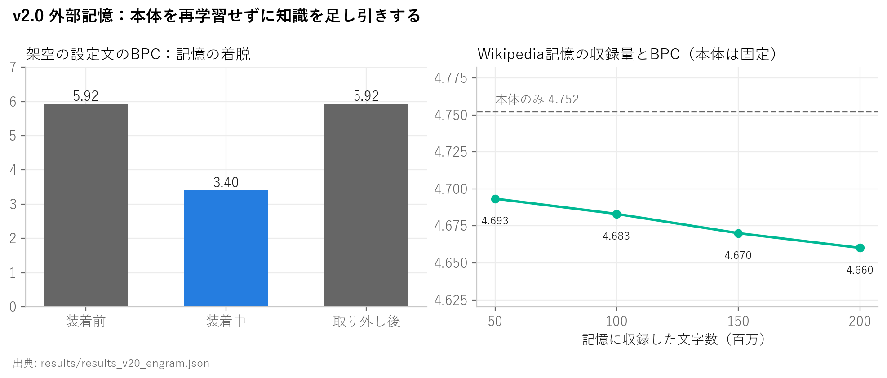
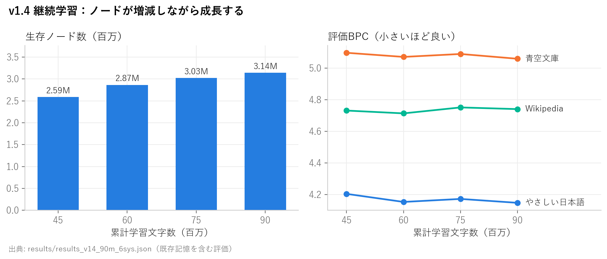

# ENNE — Engineering Neural Network Engine

ENNEは、知能を「巨大なモデルを一度学習して完成させるもの」ではなく、「設計し、育て、後から機能を足していくシステム」として作る試みです。日本語を対象に、個人のGPU（RTX 3060 12GB）1枚でv0.1からv15.2まで開発してきました。

1. **個人でもゼロから知能を育てられる。** 高価なGPUクラスタも、大規模な事前学習済みモデルも使いません。家庭用GPUで独自のモデルを構築します。
2. **知能を学習するだけでなく、設計できる。** 記憶・言語・判断などの機能を分け、それぞれに適した技術を採用します。独立した機構は交換や改良ができます。
3. **知能を完成品ではなく、成長するシステムとして扱う。** 固定されたパラメータを調整するだけでなく、学習に伴って神経回路そのものが変化します。知識や認知機能を後から追加できます。

> **English abstract.** ENNE treats a language model not as a monolithic network trained once, but as a system that is designed, grown, and extended. (1) **Built from scratch on one consumer GPU:** the core starts from only 256 UTF-8 byte nodes and grows without backprop, pretrained models, or an external tokenizer; peak VRAM stays at or below 8.4 GiB even at its largest 6M-node configuration on an RTX 3060. (2) **Designed, not only trained:** memory, language, and decision-making are separate mechanisms using different techniques — a growing byte-level graph, swappable CPU-side memories (mounting one drops BPC on a fictional document from 5.92 to 3.40; unmounting restores 5.92), a lead-sentence retrieval index, a local arbiter choosing *grounded answer / abstain / chit-chat*, plug-in tools (calculator, clock, article lookup), and an experimental metacognition module — each trained separately in milliseconds to minutes, and each switchable for ablation. (3) **Grown, not finished:** nodes are born, pruned, and merged as the model learns; because each node is addressed by its structural path, a separately trained 525k-node dialogue graph (87.6% path overlap) was merged into the base graph in 13.8 s without gradients. Facts taught during a conversation are consolidated in a "sleep" step into a new generation that is adopted only if it passes fixed checks; a deliberately false teaching was rejected automatically, and any generation can be rolled back. The core's raw BPC still trails a small Transformer's, yet the assembled system answers from retrieved sources, answers about newly added knowledge, and abstains on unknowns. On frozen, newly written 10-question sets it currently scores 5–6/10. Research code for v15.2 and result JSONs are included; trained models and data are not.

## ① 個人でもゼロから知能を育てられる

**ゼロから。** 本体は、UTF-8の256バイトに対応する感覚ノードだけから始まり、中間のノードは0個です。事前学習済みのモデルや外部のトークナイザーは使わず、学習しながらノードが生まれていきます。

**家庭用GPU 1枚で。** 開発はすべてRTX 3060（12GB）1枚で行いました。数百万ノード規模の学習でも、GPUのピーク使用量は次の程度です。

| 実験 | 規模 | GPUピーク |
|---|---|---:|
| v1.4 継続学習（9,000万文字） | 生存ノード約314万 | 5,256 MiB |
| v1.2 500万ノード枠 | 500万ノード | 5,725 MiB |
| v2.2 600万ノード枠（最大構成） | 生存ノード約454万 | 8,562 MiB |
| v15.2 推論時（記憶・索引・ツール・メタ認知込み） | — | 7,323 MiB |

誤差逆伝播を使わないため、勾配やオプティマイザの状態を保持する必要がありません。

**機能を足すときは、短い学習で済みます。**


新しい部品の学習・構築は数ミリ秒から数分で終わり、全体の再学習はいりません。記憶カートリッジ、索引、記憶ゲート、仲裁層、ツール選択、発話、世代管理、メタ認知はCPUだけで動きます（これらの部品の学習・実行で追加されるCUDA割当は0 bytes）。

## ② 知能を学習するだけでなく、設計できる

ENNEは1つの巨大なネットワークにすべてを学習させるのではなく、機能ごとに機構を分け、それぞれに合った技術を使います。

| 機能 | 機構 | 採用した技術 |
|---|---|---|
| 言語 | 本体（成長するバイトDAG） | 局所予測誤差によるノードの新生・削除・統合 |
| 言語（対話） | 対話用DAG、対話記憶、読み出し適応 | 対話データだけで別に育てたDAG、局所的な読み出し適応 |
| 記憶 | 記憶カートリッジ | CPU RAM / mmap上の文脈統計。着脱可能 |
| 記憶（事実） | 記事冒頭文索引 | 記事の定義文を優先するSQLite索引 |
| 判断 | 記憶ゲート、成長型仲裁層 | ridge回帰、十分統計を使う局所回帰。根拠回答・棄権・雑談を選ぶ |
| 行動 | ツール（計算・時計・本文検索） | プラグインとして登録。どのツールを使うかは弱教師の閉形式学習で育てたノードが選ぶ |
| 発話 | 発話ノード | 決定済みの内容に合う発話候補を、対話データから育てたノードで選ぶ |
| 自己監視 | メタ認知（試作） | 発話前に根拠を監査し、再検索・棄権と自信度を決める |
| 推論 | 応答意図への経路選択（v9） | 探索段階。比較の説明はまだできない |

**機構は交換できます。** 知識は本体の外の記憶カートリッジに置いているので、本体を再学習せずに差し替えられます。



架空の設定文から記憶カートリッジを作るのに3.9ミリ秒でした。装着すると設定文のBPCは5.92から3.40に下がり、外すと5.92に戻ります。Wikipedia記憶の収録量を5,000万文字から2億文字に増やすと、本体を固定したままBPCが4.693から4.660に下がりました。

**機構は個別に改良できます。** 検索の機構だけを、単純な6-gram索引から記事冒頭文を優先する索引に替えたところ、小規模QAで回答に含まれる評価語句が1/15から10/15に増えました。


**機構を後から足し、その効果を分けて測れます。** v13では、計算・時計・本文検索をツールとして登録できるようにし、どのツールを使うかを選ぶ部品（A）と、発話を組み立てる部品（B）を別々に足しました。部品ごとに有効・無効を切り替えられるので、同じ問題でそれぞれの寄与を測れます。問題は、コードとモデルを凍結した後に新しく作り、一度だけ評価しました。

| 構成（v13.1） | 新規10問の正答 |
|---|---:|
| どちらもなし | 2/10 |
| Aだけ | 4/10 |
| Bだけ | 2/10 |
| A＋B | 5/10 |

A＋Bで新たに正答したのは、数式・単位付きの加算・時刻の3問でした。どちらの部品も、追加で使うCUDA割当は0 bytesです。

**パーツごとにデバッグして直せます。** 応答の間違いがどの機構から来たかを特定し、その機構だけを直せます。1つの大きなネットワークでは原因の場所を特定しにくく、直すには再学習が必要になります。

- v11.2：6-gram索引が記事の本題ではなく「ついでの言及」を拾うことが原因だと特定し、索引だけを替えて回答を改善しました（上の図）。
- v12.0→v12.2：記憶ゲートが回答に必要な根拠まで閉じてしまい、回答中の評価語句が16/21から6/21に減りました。棄権、冒頭文の品質、複数対象の扱いを個別に直しました。
- v12.5以降：仲裁層・ツール・メタ認知がそれぞれ何を判断したかを、応答ごとにtraceとして記録しています。どの機構の判断で答えが決まったかを追えます。
- v13.1：計算の候補を選んだのに本文検索の得点がわずかに上回って棄権に戻る、という失敗をtraceから特定しました。ツールの選択と記憶の判断を別の軸に分けると（v13.2、演算の学習も同時に変更）、既存の文章題7問の数値がすべて正しくなりました。
- v14.0：経験からの更新を試したとき、既存の算術（机7台に付箋4枚ずつ）が28枚から11枚に退行しました。世代の採否を決める固定検査がこれを検出して更新を棄却し、演算の転移を制限してから再評価しました。

各機構の詳細は [docs/architecture.md](docs/architecture.md) を参照してください。

## ③ 知能を完成品ではなく、成長するシステムとして扱う

**神経回路そのものが変化します。** 本体は学習中に、予測を外した箇所でノードを新生し、役に立たないノードを削除し、似たノードを統合します。



9,000万文字までの継続学習では、各段階で57万〜166万のノードが生まれ、45万〜100万のノードが削除されながら、生存ノードが約259万から約314万に増えました。BPCはこの範囲ではほぼ横ばいです。

**別々に育てた回路を、後から1つに統合できます。** ENNEのノードは、256バイトを根とする「どの条件をたどって生まれたか」という経路で特定できます。そのため、別々に学習したDAG同士でも、同じ経路のノードを対応付けて重ね合わせられます。通常のニューラルネットの重みは、別々に学習するとニューロンの並び順が揃わず、そのままでは足し合わせられません。

v11では、対話データだけで別に育てた対話用DAGを、文章で育てた基盤DAGに統合しました。

| 項目 | 値 |
|---|---:|
| 対話用DAGのノード | 524,838 |
| うち基盤DAGと経路が一致したノード | 459,515（87.6%） |
| 対話用DAGにしかないノード | 65,323 |
| 基盤DAGから移植したノード | 4,051,411 |
| 対応が取れずに外したノード | 16 |
| 経路の対応付けにかかった時間 | 13.8秒（勾配計算なし） |

2つのDAGの表現の向きは、256×256の座標変換（ridge回帰で一度解くだけ）でそろえました。変換後の出力の一致度（logitのcos類似度）は0.988です。

| 構成 | GPU割当 | 対話本文BPC | 終了予測 EOT bits |
|---|---:|---:|---:|
| 対話用DAG単体（記憶あり） | — | 3.9794 | 3.145 |
| 2つのDAGを並べて使う（v10.1） | 7,323 MiB | 3.8261 | 2.519 |
| 1つに統合（v11.1） | 5,023 MiB | 3.8727 | 0.840 |

統合でGPU割当は約3割減り、対話の予測は対話用DAG単体より良くなりました。2つを並べて使う構成と比べると、本文BPCはわずかに悪く、終了予測は大きく改善しました（v11.1では統合後に終了予測の読み出しを399秒かけて調整しています）。一方で、統合後の一般文章の予測（3分野平均BPC 5.47）には課題が残っています。

**目指していること：能力ごとに育てたパーツを組み立てる。** 伸ばしたい能力のデータだけで専門のDAGを育て、経路で本体に統合すれば、全体を学習し直さずに、その能力だけを伸ばしたモデルを組み立てられるはずです。会話のパターンを持つデータで会話用のパーツを、特定分野の文章でその分野のパーツを育てる、といった使い方です。v11の統合はこの方向の最初の実証で、対話の予測は改善しましたが、一般文章の予測は落ちました。統合しても他の能力を落とさないことが、今後の一番の課題です。

**判断の機構も成長します。** v12.5の仲裁層は、学習中に33ノードが生まれ、10ノードが削除されて23ノードに落ち着きました。v13.1のツール選択ノードは549生まれて80、発話ノードは815生まれて390が残りました。

**使いながら覚え、間違った更新は戻せます（v14）。** 対話中に事実を教えたり（`/teach`）、答えを訂正したり（`/correct`）すると、経験として記録されます。「睡眠」（`/sleep`）でそれらをまとめた新しい世代の候補を作り、固定の検査（既存の回答・棄権・算術が崩れていないか）を通ったときだけ採用します。世代はいつでも前に戻せます（`/rollback`）。

| 試したこと | 結果 |
|---|---|
| 架空の事実を2件教え、時計と加算の誤りを1件ずつ訂正 | 別プロセスで読み直しても、言い換えた質問に答えた（「点検する星紡ぎ試験機は何色でしたか？」→「星紡ぎ試験機の識別色は薄紫色です。」）。訂正していない加算（6km＋9km）にも「15キロメートルです。」と答えた |
| 何も教えずに睡眠 | 棄権した4問のうち、太陽の半径の1問について、本文から根拠を自分で見つけて記憶に加えた |
| 架空の町の町長について、わざと嘘を教える | 候補の世代はその嘘を答えたが、固定検査の棄権問題が15/15から14/15に下がったため、自動で棄却された |
| 最初の世代に戻す | 初期の4問の発話・ツール値・出典が、初期の結果と完全に一致した |

固定検査の外にある嘘まで見抜ける保証はありません。世代管理の部品が追加で使うCUDA割当は0 bytesです。

**知識や認知機能を後から足してきました。** 外部記憶（v2.0）、文章検索（v2.1）、役割表現（v6）、対話（v8〜v11）、冒頭文索引（v11.2）、棄権と判断（v12）、ツールと発話（v13）、教示・睡眠・世代管理（v14）、メタ認知（v15）と、版ごとに機能を追加しています。流れは [docs/history.md](docs/history.md) にあります。

## 現在の到達点（v15.2）：BPCは高めでも、応答はできる

**ENNEでは、本体のBPC（1文字あたりのビット数）は最終的な性能の基準になりません。** 応答は検索・選択・判断の組み合わせで決まるため、本体の予測損失と応答の質は連動しません。記録にもそれが表れています。

- v11.2で検索を冒頭文索引に替えると、回答中の評価語句は1/15から10/15に増えましたが、同じ実験の平均BPCは5.26から5.40に悪化しました。
- v9では、自己採点のBPCが低い回答（平均2.82）を選んでも、回答語句の一致は15個中1個でした。

そのためENNEは、BPCではなく応答の結果で評価します。本体単独のBPCは小さなTransformerの参考値より悪い値ですが（限界を参照）、機構を組み合わせたシステムとしては質問に答えられます。以下はv15.2の実際の出力です。

```
Q: 富士山とは何ですか？簡単に教えてください。
A: 富士山は、静岡県（富士宮市、富士市、裾野市、御殿場市、駿東郡小山町）と山梨県（富士吉田市、
   南都留郡鳴沢村）に跨る活火山である。標高3776.12 m、日本最高峰（剣ヶ峰）の独立峰で、…

Q: 第二次世界大戦はいつ始まり、いつ終わりましたか？
A: 第二次世界大戦は、1939年（昭和14年）9月1日から1945年（昭和20年）8月15日または9月2日まで
   約6年にわたって続いた…

Q: アストラX-99の最大推力はどのくらいですか？          ← 後から足した記憶にだけある架空の設定
A: アストラX-99の最大推力は従来のイオンエンジンの約400倍であり、火星までの航行時間をわずか18日間に短縮できる。

Q: 架空の都市「ネオアトランティス2099」の市長は誰ですか？
A: ネオアトランティス2099については情報がありません。

Q: こんにちは！調子はどうですか？
A: うまくいってるよ。

Q: (74 - 26) * 3 / 8                                    ← 以下2問は凍結後に作った新規問題
A: 18です。

Q: 作業台に封筒を17枚並べました。さらに6枚の封筒を加えたら、全部で何枚になりますか。
A: 23枚です。
```

苦手な問題もはっきりしています。

```
Q: 朝に14枚の切符を用意し、昼に9枚を追加しました。いま切符は合計何枚ですか？
A: 5枚です。                                            ← 足し算を引き算と取り違える

Q: おはよう！ 今朝はどんな調子で過ごしていますか？
A: 宇宙の答えは不合理ではない。                          ← 質問に合わない文を選ぶ
```

**未見の問題での結果。** 版ごとに、コード・モデル・索引を凍結した後で新しい10問を作り、一度だけ評価しています。

| 版 | 比べた条件 | 新規10問の正答 |
|---|---|---:|
| v13.0 | ツールなし → あり | 2 → 4 |
| v13.1 | 部品なし / Aだけ / Bだけ / A＋B | 2 / 4 / 2 / 5 |
| v13.2 | ツールなし / 混合 / 二軸 | 1 / 1 / 3 |
| v15.0 | メタ認知なし → あり | 1 → 3 |
| v15.1 | メタ認知なし → あり | 5 → 4 |
| v15.2 | メタ認知なし → あり | 6 → 5 |

問題は版ごとに作り直しているため、版をまたいだ点数は比べられません。v15.0〜v15.2の「メタ認知なし」はほぼ同じモデルですが、問題によって1/10から6/10までばらつきました。

既知の31問（回帰評価）では、厳格な採点で25/31、架空の対象への棄権5/5、UTF-8として正しい出力とEOTでの終了31/31です。

**メタ認知は試作の段階です。** v15では、発話の前に根拠を監査して、再検索・棄権と自信度を決める部品を足しました。開発用の50問では、自信度が高い回答ほど正答率が高くなりました（HIGH 10/13、MEDIUM 2/10、LOW 1/27）。新規10問では、無関係な文を返していた2問を棄権に変えた一方、正答していた琵琶湖と霞ヶ浦の比較も棄権にしてしまい、正答はメタ認知なしの6/10より少ない5/10でした。

全出力は [results/results_v152_metacog.json](results/results_v152_metacog.json) にあります。

## サンプルコード

[examples/toy_enne.py](examples/toy_enne.py) は、ENNEの考え方を約200行で示す簡略版です。研究本体の実装ではありません。依存ライブラリなし、CPUだけで1秒ほどで動きます。

```
python examples/toy_enne.py
```

```
1. ゼロから育てる（誤差逆伝播なし）
   開始時: 感覚ノード 256 / 中間ノード 0
   ラウンド1: 中間ノード   211（累計 新生   270 / 削除    59）  未見文のBPC 5.58
   ラウンド4: 中間ノード   424（累計 新生   624 / 削除   200）  未見文のBPC 4.82

2. 知識を本体の外に置き、着脱する（本体は再学習しない）
   架空の設定文のBPC  装着前 22.33 → 装着中 2.29 → 取り外し後 22.33

3. 別々に育てたグラフを 1 つに統合する
   対話グラフの中間ノードのうち、文章グラフと同じ経路を持つもの: 37.2%
                     文章のBPC    対話のBPC
   文章だけ                4.87     13.70
   対話だけ               17.71      4.52
   統合後                 5.56      4.19
```

サンプルでは、ノードを可変長の文脈統計として素朴に実装しています。研究本体の連続表現、作業記憶、GPUカーネル、ゲートや仲裁の学習、統合時の座標変換は含みません。数値は数百文字の短い文章での結果で、研究本体の結果とは別物です。

## 限界

- **本体の予測性能はまだ低いです。** 587万パラメータのTransformerを約5分学習した参考値はBPC 3.80で、ENNE本体は4.23でした。ただしTransformerはやさしい日本語だけを学習した専用モデルで、まれな文字を`<UNK>`にまとめて評価しているため、Transformerに有利な比較です。
- **Transformerとの学習コストの公平な比較は、まだしていません。** 保存済みの参考比較は、学習データ（Transformerはやさしい日本語のみ、ENNEは3分野）、入力（Transformerは4,096文字の語彙で残りを`<UNK>`にまとめる、ENNEは全バイトを扱う）、計時の範囲（ENNEは評価や枝刈りの時間を含む）が異なります。
- **本体を大きくしたら悪化しました。** 600万ノード枠への拡張と追加学習で、3分野とも本体のBPCが悪化しました（例：Wikipedia 4.75→4.85）。
- **知識を問う回答の多くは、検索した冒頭文をほぼそのまま返したものです。** 違いを説明する問い（「PythonとC++の違い」など）では定義を並べるだけで、比較できていません。本文に答えがあっても、見出しや語義の選択を誤ると棄権します。
- **文章題の演算の選び方が不安定です。** 計算そのものは検算していますが、どの演算を使うかを文から選び間違えることがあります（「14枚に9枚を追加」→「5枚です。」）。
- **雑談の応答が質問に合わないことがあります。** 学習した発話から選ぶため、挨拶に無関係な文を返すことがあります。
- **仲裁層とメタ認知はまだ優位性を示していません。** v12.5の31問では、単一ゲート・静的合議・成長型仲裁の3方式に差がありませんでした。メタ認知は、新規問題の正答をv15.0では2問増やしましたが、v15.1・v15.2ではどちらも1問減らしました。
- **応答の評価がまだ小さいです。** 未見の問題での評価は始めましたが、各版10問、単一seedです。作問と採点は同じ担当者が行っていて、外部の採点者はいません。正答は5〜6/10にとどまります。結果で評価する以上、これが一番の弱点です。次は問題数を増やし、外部の採点者を入れます。関連研究との比較も未実施です。

詳細は [docs/results.md](docs/results.md)、開発の流れは [docs/history.md](docs/history.md) にあります。結果JSONに出てくる Cortex、Hippocampus、Broca などの名前は設計上の比喩で、脳を再現したという主張ではありません。

## リポジトリ構成

```
docs/           方式・結果と限界・開発履歴
figures/        README の図（scripts/make_figures.py で results/ から生成）
results/        各版の結果JSON（評価の一次資料）
scripts/        図の生成スクリプト
examples/       考え方を示す簡略サンプル（研究本体の実装ではない）
src/neurograph/ v15.2 時点の研究コード（現行版の動作に必要な部分）
```

## ソースコードについて

v15.2 時点の研究コードのうち、現行の対話システムと DAG 統合を動かすのに必要な部分を `src/neurograph/` に置いています。研究時のコードから変えたのは、実験機のパスと GPU の指定を環境変数にした点と、コメントを整理した点だけです。構成・動作環境・入口は [docs/source.md](docs/source.md) にまとめました。

README・docs・結果JSONは、`src/neurograph/` と同じ v15.2 時点の内容にそろえています。ソースを更新するときは、README も同時に更新します。

学習済みモデル、記憶カートリッジ、検索索引、学習データは含みません。そのため、このリポジトリだけでは対話システムは動きません。仕組みを手元で試すには [サンプルコード](#サンプルコード) を使ってください。

## データとライセンス

このリポジトリの文書・図・スクリプト・ソースコードは [MIT License](LICENSE) です。

学習・評価にはWikipedia日本語版、青空文庫、やさしい日本語コーパス、公開の日本語対話データ（magpie_ja、wiki_conv_ja、oasst1_ja、dolly_ja）を使いました。`results/` の出力例にはWikipedia本文に由来する文が含まれます。これらは [CC BY-SA 4.0](https://creativecommons.org/licenses/by-sa/4.0/) の下にあり、MIT Licenseの対象外です。
