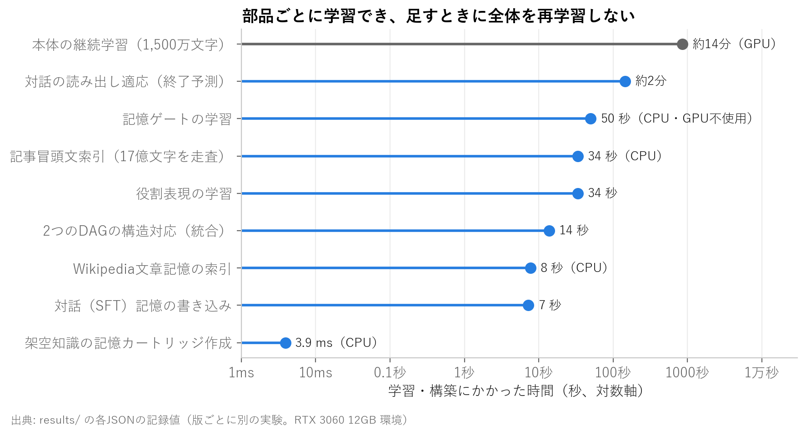
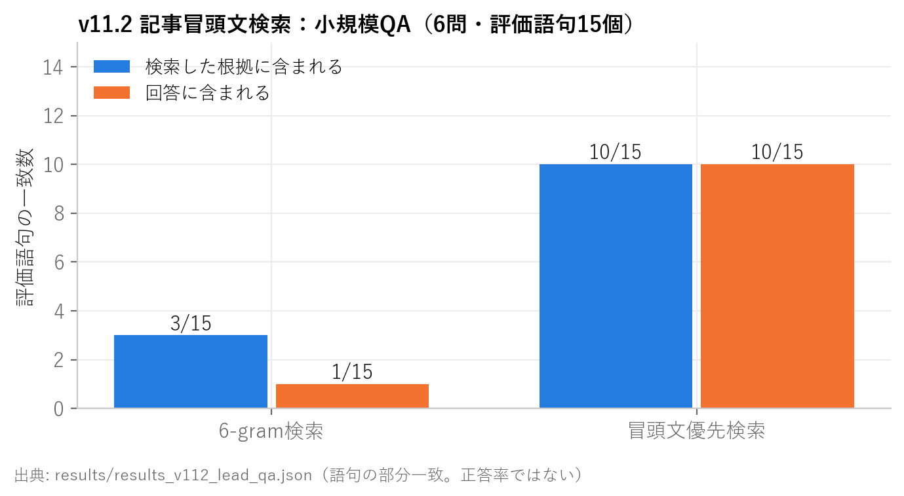

# ENNE — Engineering Neural Network Engine

ENNEは、部品ごとに学習して後から組み合わせる日本語の言語モデルです。本体、記憶、検索、対話、判断の部品を別々に学習し、新しい部品を後から足していけます。本体の学習に誤差逆伝播（backprop）は使わず、局所的な予測誤差だけでノードが増えたり減ったりします。個人のGPU（RTX 3060 12GB）で、v0.1からv12.5まで開発してきた記録です。

> **English abstract.** ENNE is a modular, backprop-free Japanese language model built on a single consumer GPU (peak VRAM ≤ 8.4 GiB even at its largest, 6M-node configuration). Instead of training one monolithic network end-to-end, each part — a growing UTF-8 byte-level core, swappable knowledge memories, a lead-sentence retrieval index, dialogue adapters, and a growing local arbiter that chooses *grounded answer / abstain / chit-chat* — is trained separately in milliseconds to minutes, many on CPU only, and added without retraining the rest. A fictional-knowledge memory builds in 3.9 ms and drops BPC on that text from 5.92 to 3.40 when mounted (back to 5.92 when removed). The core's raw BPC is still worse than a small Transformer's, yet the assembled system answers factual questions from retrieved sources, answers about newly mounted knowledge, and abstains on unknowns. Raw result JSONs are included; the source code will be released once the research settles.

## 3つの特徴

### 1. 部品ごとに学習でき、後から足せる

ENNEは1つの巨大なネットワークをまとめて学習しません。部品はそれぞれ独立に学習し、組み合わせて使います。

| 部品 | 役割 | 足したときに変わること |
|---|---|---|
| 本体（成長するバイトDAG） | 次バイトの予測、文章の流暢さ | — |
| 記憶カートリッジ | 分野知識・独自知識 | 本体を再学習せずに知識を着脱 |
| 記事冒頭文索引 | 百科事典的な事実の検索 | 事実を問う質問に根拠つきで答える |
| 対話記憶・読み出し適応 | 対話の文体、応答の終わり | 会話として応答し、適切に止まる |
| 記憶ゲート・仲裁層 | 根拠回答・棄権・雑談の選択 | 知らないことに「情報がありません」と答える |

開発の過程でも、役割表現、対話専用DAG、DAG統合などの部品を版ごとに足してきました。部品の構成は [docs/architecture.md](docs/architecture.md) を参照してください。

### 2. 学習コストが低い

**一般向けGPU 1枚で学習できます。** 開発はすべてRTX 3060（12GB）1枚で行いました。数百万ノード規模の学習でも、GPUのピーク使用量は次の程度です。

| 実験 | 規模 | GPUピーク |
|---|---|---:|
| v1.4 継続学習（9,000万文字） | 生存ノード約314万 | 5,256 MiB |
| v1.2 500万ノード枠 | 500万ノード | 5,725 MiB |
| v2.2 600万ノード枠（最大構成） | 生存ノード約454万 | 8,562 MiB |
| v12.5 推論（記憶・索引込み） | — | 7,323 MiB |

誤差逆伝播を使わないため、勾配やオプティマイザの状態を保持する必要がありません。

**機能を足すときは、部品単位の短い学習で済みます。**



新しい部品の学習・構築は数ミリ秒から数分で終わり、全体の再学習はいりません。記憶カートリッジ、索引、記憶ゲート、仲裁層はCPUだけで学習できます（ゲートと仲裁層の学習時のCUDA使用量は0 bytes）。知識を1つ足すだけなら、架空の設定文から記憶を作るのに3.9ミリ秒（v2.0）、独自知識の装着に0.10〜0.16ミリ秒（v6.2〜v6.4）でした。


その記憶を装着すると、設定文のBPCは5.92から3.40に下がり、外すと5.92に戻ります。Wikipedia記憶の収録量を5,000万文字から2億文字に増やすと、本体を固定したままBPCが4.693から4.660に下がりました。

### 3. BPCは高めでも、応答はできる

本体単独のBPC（1文字あたりのビット数）は、小さなTransformerより悪い値です（後述）。それでも、部品を組み合わせたシステムとしては質問に答えられます。以下はv12.5の実際の出力です。

```
Q: 富士山とは何ですか？簡単に教えてください。
A: 富士山は、静岡県（富士宮市、富士市、裾野市、御殿場市、駿東郡小山町）と山梨県（富士吉田市、
   南都留郡鳴沢村）に跨る活火山である。標高3776.12 m、日本最高峰（剣ヶ峰）の独立峰で、…

Q: 第二次世界大戦はいつ始まり、いつ終わりましたか？
A: 第二次世界大戦は、1939年（昭和14年）9月1日から1945年（昭和20年）8月15日または9月2日まで
   約6年にわたって続いた…

Q: アストラX-99の最大推力はどのくらいですか？          ← 後から足した記憶にだけある架空の設定
A: アストラX-99の最大推力は従来のイオンエンジンの約400倍であり、火星までの航行時間をわずか18日間に短縮できる。

Q: 架空の都市「ネオアトランティス2099」の市長は誰ですか？
A: ネオアトランティス2099については情報がありません。

Q: こんにちは！調子はどうですか？
A: うまくいってるよ。
```

31問の回帰評価では、指定した棄権9/9、UTF-8として正しい出力とEOTでの終了31/31でした。全31問の出力は [results/results_v125_arbiter.json](results/results_v125_arbiter.json) にあります。



応答の質を大きく上げたのは記事冒頭文索引という部品です。小規模QA（6問・評価語句15個）で、回答に含まれる評価語句が1/15から10/15に増えました。

## 限界

- **本体の予測性能はまだ低いです。** 587万パラメータのTransformerを約5分学習した参考値はBPC 3.80で、ENNE本体は4.23でした。ただしTransformerはやさしい日本語だけを学習した専用モデルで、まれな文字を`<UNK>`にまとめて評価しているため、Transformerに有利な比較です。
- **Transformerとの学習コストの公平な比較は、まだしていません。** 保存済みの参考比較は、学習データ（Transformerはやさしい日本語のみ、ENNEは3分野）、入力（Transformerは4,096文字の語彙で残りを`<UNK>`にまとめる、ENNEは全バイトを扱う）、計時の範囲（ENNEは評価や枝刈りの時間を含む）が異なります。
- **本体を大きくしたら悪化しました。** 600万ノード枠への拡張と追加学習で、3分野とも本体のBPCが悪化しました（例：Wikipedia 4.75→4.85）。
- **知識を問う回答の多くは、検索した冒頭文をほぼそのまま返したものです。** 違いを説明する問い（「PythonとC++の違い」など）では定義を並べるだけで、比較できていません。語用や算数も苦手です。
- **仲裁層はまだ優位性を示していません。** v12.5の31問では、単一ゲート・静的合議・成長型仲裁の3方式に差がありませんでした。
- **評価が小さいです。** 単一seed、数十問規模で、開発中に繰り返し見た問題が中心です。関連研究との比較も未実施です。

詳細は [docs/results.md](docs/results.md)、開発の流れは [docs/history.md](docs/history.md) にあります。結果JSONに出てくる Cortex、Hippocampus、Broca などの名前は設計上の比喩で、脳を再現したという主張ではありません。

## リポジトリ構成

```
docs/           方式・結果と限界・開発履歴
figures/        README の図（scripts/make_figures.py で results/ から生成）
results/        各版の結果JSON（評価の一次資料）
scripts/        図の生成スクリプト
```

## ソースコードについて

研究途中のため、ソースコードは現時点では公開していません。方式は [docs/architecture.md](docs/architecture.md) で説明し、数値の根拠として各版の結果JSONを `results/` に置いています。学習済みモデル、学習データ、検索索引も含めていません。コードは研究がまとまった段階で公開する予定です。

## データとライセンス

このリポジトリの文書・図・スクリプトは [MIT License](LICENSE) です。

学習・評価にはWikipedia日本語版、青空文庫、やさしい日本語コーパス、公開の日本語対話データ（magpie_ja、wiki_conv_ja、oasst1_ja、dolly_ja）を使いました。`results/` の出力例にはWikipedia本文に由来する文が含まれます。これらは [CC BY-SA 4.0](https://creativecommons.org/licenses/by-sa/4.0/) の下にあり、MIT Licenseの対象外です。
