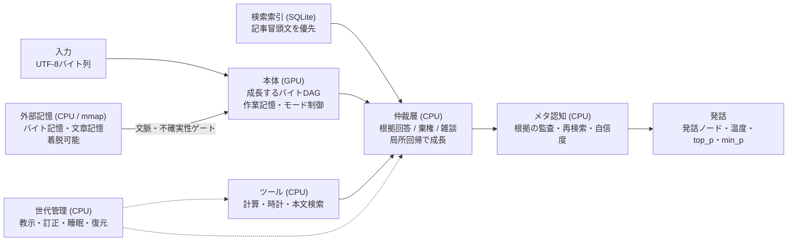
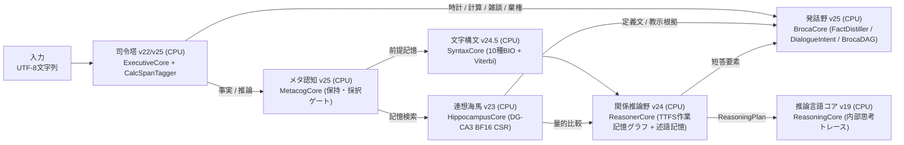

# 方式

ENNEは、学習方式の異なる部品を組み合わせた構成です。本体の層と制御の層はどちらも誤差逆伝播を使いません。

## 部品と学習方法

各部品は別々に学習し、他の部品を再学習せずに追加・交換できます。時間は `results/` の記録値で、版ごとに別の実験です。

| 部品 | 学習方法 | 学習・構築の時間 | 実行場所 |
|---|---|---|---|
| 本体DAG | 局所誤差によるノードの新生・削除・統合と重み更新 | 1,500万文字あたり約14分（v1.4） | GPU |
| 役割表現 | HRR束縛と局所学習 | 34秒（v6.0） | — |
| 記憶カートリッジ（バイト） | 文脈統計の書き込み | 分野ごとに25〜49秒、架空知識は3.9ms（v2.0） | CPU / mmap |
| 文章記憶 | 転置索引の構築 | 4〜8秒（v2.1） | CPU |
| 対話（SFT）記憶 | 対話データの書き込み | 7秒（v8.0） | — |
| 読み出し適応 | 局所的な読み出しの適応 | 144秒（v8.0） | — |
| DAG統合 | 経路の対応付けとridge回帰による座標変換 | 構造対応14秒（v11.0） | — |
| 記事冒頭文索引 | 17億文字を走査してSQLiteに保存 | 34秒（v11.2） | CPU |
| 記憶ゲート | ridge回帰 | 50秒（v12.1） | CPU、CUDA 0 bytes |
| 成長型仲裁層 | 十分統計に基づく局所閉形式回帰、ノード成長 | 記録なし | CPU、CUDA 0 bytes |
| ツール選択ノード | 弱教師による閉形式学習、ノード成長（549生まれて80が残る） | 記録なし（v13.1） | CPU、CUDA 0 bytes |
| 発話ノード | 対話データから成長（815生まれて390が残る） | 記録なし（v13.1） | CPU、CUDA 0 bytes |
| 進化世代 | 経験の記録、睡眠で候補を作り固定検査で採否 | 記録なし（v14.0） | CPU、CUDA 0 bytes |
| メタ認知 | 閉形式 ridge と局所中心（96生まれて82が残る）、単調校正 | 記録なし（v15.0〜v15.2） | CPU、CUDA 0 bytes |

「—」は保存結果から実行場所を確定できないものです。

## 1. 本体：成長するバイトDAG

- **入力単位。** 感覚ノードはUTF-8の256バイトだけです。外部の事前学習済みトークナイザーは使わず、未知語（`<UNK>`）も発生しません。ただし後の版では、バイト列から可変長の単位（モーター単位）を学習して出力に使うため、「分割処理が一切ない」わけではありません。
- **走査。** 現在のバイトに対応する感覚ノードから出発し、直前の文字や離れた文脈のノードを条件として枝を辿ります。簡単な文脈は浅い経路、難しい文脈は深い経路で予測します。
- **新生。** 各ノードは予測の外れ（surprise）を累積します。葉のノードで外れが続くと、空きプールから子ノードを割り当てて新しい条件付きの枝を張ります。
- **削除・統合。** めったに発火しないノードや、親より予測誤差を下げないノードは削除され、IDはプールに戻ります。似た役割のノードは統合されます。
- **更新。** 重みは、各ノードで観測した次バイトとの誤差に基づいて局所的に更新します。

ノード数の上限（プール）、接続表のバケット数、新生・削除の閾値などは明示的な設定値です。

## 2. 作業記憶とモード制御

本体には、ゲート付きの作業記憶スロットと短期記憶、文章の特徴から推定するモード（文体・分野）制御があります。後の版では、文中の役割（主語・目的語など）をHRR（循環シフトと符号反転による束縛）で表す役割表現も加えました。

## 3. 外部記憶：本体と知識の分離

GPU上の本体とは別に、CPU RAMやmmap上に「カートリッジ」として記憶を置きます。

- **バイト記憶（v2.0）。** 文脈の指紋と次バイトの統計を格納します。文脈ゲートと本体の不確実性ゲートで、予測にどれだけ介入するかを決めます。
- **文章記憶（v2.1）。** 文章を約240バイトの断片に区切り、6・9バイトの転置索引で検索します。
- **着脱。** カートリッジの装着・取り外しは本体を再学習せずに行えます。取り外すとその記憶による予測への影響は消えます。本体に学習済みの知識を消すことはできません。

## 4. 対話への適応とDAG統合

- **SFT記憶と読み出し適応（v8.0）。** 対話データを記憶として加え、応答の終了（EOT）を予測するよう読み出しを局所的に適応させました。
- **対話用DAG（v10）。** 対話専用のDAGを別に育て、基盤DAGと並べて使いました。
- **DAG統合（v11）。** 別々に学習したDAG同士を統合できるのはENNEの特徴の一つです。各ノードは256バイトを根とする構造上の経路で特定できます。対話用DAGの87.6%のノードが基盤DAGと同じ経路を持っていました。経路を対応付け、座標変換（ridge回帰で求める256×256の行列）で表現をそろえて、2つのDAGを1つに統合しました。GPU割当は減りましたが、一般文章の予測は悪化しました。

## 5. 検索：記事冒頭文の優先（v11.2）

単純な6-gram索引は、記事の本題ではなく、ついでに言及された箇所を拾いがちでした。そこでコーパスを走査して記事の冒頭段落（定義文）を検出し、見出しをキーとするSQLite索引に保存しました。17億文字を走査して約73万見出しを登録し、索引の容量は約401MBです。

## 6. 制御：記憶ゲートから成長型仲裁へ

- **記憶ゲート（v12.0）。** 質問と検索文の一致、主題、数値の不一致などの11特徴から、検索した根拠を使うかどうかをridge回帰で決めます。
- **棄権と温度の分離（v12.1〜v12.3）。** 実体・履歴・検索・採否を先に確定させ、その後で発話に温度を適用します。棄権は学習済みの全文経路を使います。
- **合議（v12.4）。** 語彙・意味・語用の判定を学習し、候補を合議で採点します。
- **成長型仲裁層（v12.5）。** 文脈に近い局所ノードが、GROUNDED（根拠回答）・ABSTAIN（棄権）・SOCIAL（雑談）を選びます。各ノードは十分統計を蓄積して線形方程式を解くことで更新されるため、誤差逆伝播を使いません。ノード数の上限は64、成長の類似度閾値は0.88です。最新の学習では33ノードが生まれ、10ノードが削除されて23ノードが残りました。

仲裁層の教師信号は、回答のbigramや実体の被覆などから作った弱教師で、人が付けた正答ラベルではありません。logitの計算後に構造上の制約も適用しています。

## 7. ツールと発話（v13）

- **ツールの登録（v13.0）。** ツールは名前・説明・候補を返す関数・実行する関数を持つプラグインとして登録します。組み込みは計算（四則演算を有理数で検算）、時計、本文検索（記事本文の位置をSQLiteに持ち、seek/readで読む。1回の読み取りの中央値は約0.005ms）の3つです。
- **選択と発話の分離（v13.1）。** どのツールを使うかを選ぶ部品と、決定済みの内容から発話を組み立てる部品を分け、それぞれ有効・無効を切り替えられるようにしました。
- **二軸化（v13.2）。** 外部行動（ツール）と記憶の判断を別々の軸で決めます。ツールの候補がすべて失敗したときだけ、記憶側の仲裁に進みます。

## 8. 教示・睡眠・世代管理（v14）

対話中の教示（`/teach`）や訂正（`/correct`）は経験として記録されます。睡眠（`/sleep`）では、親の世代を複製した候補に経験をまとめ、親と候補の両方で実際に応答を生成して比べます。既存の回答・棄権・算術を崩さず、経験について改善した候補だけを新しい世代として採用し、ポインタを原子的に置き換えます。棄却された候補は理由とともに台帳に残ります。`/rollback` で任意の世代に戻せます。

世代として管理するのはCPU側の記憶とノードで、本体DAGや発話器の重みは共有しています。

## 9. メタ認知（v15）

発話の前に、質問と根拠の文字の一致、主題のずれ、語義の分野、評者の不一致、演算の妥当性などを監査します。問題があれば、脇の実体を外して再検索する（REFOCUS）、不整合な候補を外す（RETRY_NEXT）、裏付けがなければ棄権に落とす（DEMOTE_ABSTAIN）のいずれかを、最大2回まで行います。最終的な回答には、開発用データで校正した自信度（HIGH / MEDIUM / LOW）を付けます。

## 用語について

結果JSONに出てくる Cortex、Hippocampus、Broca、Thalamus などの名前は設計上の比喩で、脳の計算機構を再現したという主張ではありません。結果JSON内の説明文やキー名には開発中の呼び方が残っていますが、根拠として読む場合は [results.md](results.md) を優先してください。

---

## v19.0〜v25.0：純 Rust CPU テキスト経路（`enne-rs/`）

v18 以降では GPU を使わず、CPU のみで動作する Rust 実装（`enne-rs/`）へテキスト経路の学習・推論を移しました。各モジュールは誤差逆伝播や事前学習済み言語モデルを使わず、競合オヤ・ヘブ学習、局所デルタ則、疎分散連想記憶、BF16 成長グラフのいずれかで学習し、バイナリチェックポイントから読み込みます。コード内の次元数・学習率・閾値はすべて明示的な設計値です。

### テキスト経路の各部品（`enne-rs` v25.0）

| 部品 | 学習・推論手法 | 学習・構築時間（CPU） | チェックポイント容量 | 形式 |
|---|---|---|---|---|
| 司令塔（`ExecutiveCore`） | 文字 1..4-gram + 構造特徴上の競合オヤ・ヘブ k-WTA（128素子・top-16）と局所デルタ分類、5タグ BIO Viterbi 抽出（`CalcSpanTagger`） | 2.53秒（v22.0） | 1.58 MiB | `NGEC2501` |
| 連想海馬（`HippocampusCore`） | オフライン索引（756,941 見出し）を DG（1,048,576細胞）→ CA3 BF16 CSR（6,753,200辺）へ封印、NMS + ヘブ数値/単位/比較読み出し、`teach` オンライン書込 | 9.23秒（v23.0） | 366.87 MiB | `NGHC2301` |
| 文字構文解析（`SyntaxCore`） | 文字窓・文字種遷移上の競合オヤ・ヘブ k-WTA（64素子・top-8）＋ 10種 BIO（SEP/FUNC/ENT/ATTR/NUM/PRED）遷移行列 Viterbi 復号 | 5.76秒（v24.5） | 1.28 MiB | `NGSX2451` |
| 関係推論野（`ReasonerCore`） | 再帰スパイキング TTFS 作業記憶グラフ（$\gamma = 0.75$）による閉路・到達・順位計算、対照ヘブ述語記憶、3種読み出し頭 | 1.09秒（v24.0） | 1.95 MiB | `NGRC2451` |
| メタ認知制御（`MetacogCore`） | 単一節前提の保持判定（64素子・top-8）と 7次元想起テレメトリ上の根拠採択パーセプトロン | `BrocaCore` と合わせ 25.99秒（v25.0） | 0.16 MiB | `NGMC2501` |
| 発話野（`BrocaCore`） | 定義文蒸留（4タグ BIO `FactDistiller`）、7意図分類（`DialogueIntentHead`）、14行動・ネイティブポインター語彙 260 の BF16 DAG（`BrocaDAG`、1,714ノード） | 25.99秒に含む（v25.0） | 23.40 MiB | `NGBC2501` |
| 推論言語コア（`ReasoningCore`） | ネイティブポインター語彙 260・UTF-8 文字 14 ホップ BF16 DAG（11,135 生存ノード）・命令キューバンク（内部説明 `explain` 用に任意マウント） | 920.33秒（96,000件, v19.0） | — | — |

### 一時キャッシュノード（作業記憶グラフの動的構築と前提消去）

会話中の一時前提や未知実体を扱うため、`ReasonerCore` は固定サイズのスロット枠ではなく、セッション前提の保持配列とクエリ単位の動的グラフを組み合わせて推論します。

1. **セッション内前提の保持（`observe_turn`）**: 複数ターンで入力された前提文は `turns: Vec<String>` に保持されます。
2. **節復号とローカルグラフ構築（`reason_plan`）**: 推論ごとに `SyntaxCore` が `turns` と現在入力を再解析して節と `Entity` / `Attr` / `Num` / `Pred` / `Func` スパンに分解し、文脈に応じてローカルな `NeuralWorkingGraph` を動的に確保して一時シナプス（有向順序・同値・所属・抑制・数値など）で結びます。
3. **TTFS 伝播とポインター直結**: シナプス行列積の再帰伝播（初到達スパイク電位 $H_{ij} = \gamma^{t-1},\ \gamma = 0.75$）で閉路（矛盾）・到達性・順位・差分を計算したあと、ローカルグラフは関数終了時に解放されます。特定した実体や数値は長期重みに書き込まず `ReasoningPlan` 経由で `
`・`<V>`・`<ANS>` のポインターとして `BrocaCore`（短答）や `ReasoningCore`（思考トレース）へ渡します（`results_v190.json` の `nocache_contains: 0` は、同一の `ReasoningPlan` を与えて生成器側の `use_cache` を切った条件で、320件の出力中に正解文字列を含むものが 0 件だったことを示す計測値です）。
4. **セッション終了時の前提消去（`reset_history` / `apoptosis`）**: 会話や問題の区切りで `reset_history`（内部で `apoptosis()`）を呼ぶと `turns.clear()` により一時前提が破棄され、次セッションには引き継がれません。

なお、現在開発途中の音声入出力（`ear` / `repair` / `audio`）および分離中の人格モジュール（`persona*`）は、公開用 `enne-rs/` の収録対象から除いています。
