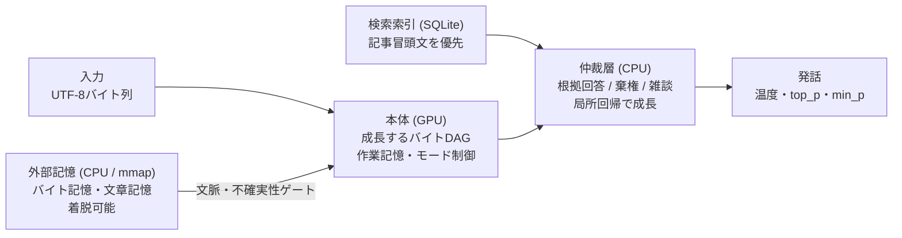

# 方式

ENNEは、学習方式の異なる4つの層を組み合わせた構成です。本体の層と制御の層はどちらも誤差逆伝播を使いません。

## 部品と学習方法

各部品は別々に学習し、他の部品を再学習せずに追加・交換できます。時間は `results/` の記録値で、版ごとに別の実験です。

| 部品 | 学習方法 | 学習・構築の時間 | 実行場所 |
|---|---|---|---|
| 本体DAG | 局所誤差によるノードの新生・削除・統合と重み更新 | 1,500万文字あたり約14分（v1.4） | GPU |
| 役割表現 | HRR束縛と局所学習 | 34秒（v6.0） | — |
| 記憶カートリッジ（バイト） | 文脈統計の書き込み | 分野ごとに25〜49秒、架空知識は3.9ms（v2.0） | CPU / mmap |
| 文章記憶 | 転置索引の構築 | 4〜8秒（v2.1） | CPU |
| 対話（SFT）記憶 | 対話データの書き込み | 7秒（v8.0） | — |
| 読み出し適応 | 局所的な読み出しの適応 | 144秒（v8.0） | — |
| DAG統合 | 経路の対応付けとridge回帰による座標変換 | 構造対応14秒（v11.0） | — |
| 記事冒頭文索引 | 17億文字を走査してSQLiteに保存 | 34秒（v11.2） | CPU |
| 記憶ゲート | ridge回帰 | 50秒（v12.1） | CPU、CUDA 0 bytes |
| 成長型仲裁層 | 十分統計に基づく局所閉形式回帰、ノード成長 | 記録なし | CPU、CUDA 0 bytes |

「—」は保存結果から実行場所を確定できないものです。

## 1. 本体：成長するバイトDAG

- **入力単位。** 感覚ノードはUTF-8の256バイトだけです。外部の事前学習済みトークナイザーは使わず、未知語（`<UNK>`）も発生しません。ただし後の版では、バイト列から可変長の単位（モーター単位）を学習して出力に使うため、「分割処理が一切ない」わけではありません。
- **走査。** 現在のバイトに対応する感覚ノードから出発し、直前の文字や離れた文脈のノードを条件として枝を辿ります。簡単な文脈は浅い経路、難しい文脈は深い経路で予測します。
- **新生。** 各ノードは予測の外れ（surprise）を累積します。葉のノードで外れが続くと、空きプールから子ノードを割り当てて新しい条件付きの枝を張ります。
- **削除・統合。** めったに発火しないノードや、親より予測誤差を下げないノードは削除され、IDはプールに戻ります。似た役割のノードは統合されます。
- **更新。** 重みは、各ノードで観測した次バイトとの誤差に基づいて局所的に更新します。

ノード数の上限（プール）、接続表のバケット数、新生・削除の閾値などは明示的な設定値です。

## 2. 作業記憶とモード制御

本体には、ゲート付きの作業記憶スロットと短期記憶、文章の特徴から推定するモード（文体・分野）制御があります。後の版では、文中の役割（主語・目的語など）をHRR（循環シフトと符号反転による束縛）で表す役割表現も加えました。

## 3. 外部記憶：本体と知識の分離

GPU上の本体とは別に、CPU RAMやmmap上に「カートリッジ」として記憶を置きます。

- **バイト記憶（v2.0）。** 文脈の指紋と次バイトの統計を格納します。文脈ゲートと本体の不確実性ゲートで、予測にどれだけ介入するかを決めます。
- **文章記憶（v2.1）。** 文章を約240バイトの断片に区切り、6・9バイトの転置索引で検索します。
- **着脱。** カートリッジの装着・取り外しは本体を再学習せずに行えます。取り外すとその記憶による予測への影響は消えます。本体に学習済みの知識を消すことはできません。

## 4. 対話への適応とDAG統合

- **SFT記憶と読み出し適応（v8.0）。** 対話データを記憶として加え、応答の終了（EOT）を予測するよう読み出しを局所的に適応させました。
- **対話用DAG（v10）。** 対話専用のDAGを別に育て、基盤DAGと並べて使いました。
- **DAG統合（v11）。** 別々に学習したDAG同士を統合できるのはENNEの特徴の一つです。各ノードは256バイトを根とする構造上の経路で特定できます。対話用DAGの87.6%のノードが基盤DAGと同じ経路を持っていました。経路を対応付け、座標変換（ridge回帰で求める256×256の行列）で表現をそろえて、2つのDAGを1つに統合しました。GPU割当は減りましたが、一般文章の予測は悪化しました。

## 5. 検索：記事冒頭文の優先（v11.2）

単純な6-gram索引は、記事の本題ではなく、ついでに言及された箇所を拾いがちでした。そこでコーパスを走査して記事の冒頭段落（定義文）を検出し、見出しをキーとするSQLite索引に保存しました。17億文字を走査して約73万見出しを登録し、索引の容量は約401MBです。

## 6. 制御：記憶ゲートから成長型仲裁へ

- **記憶ゲート（v12.0）。** 質問と検索文の一致、主題、数値の不一致などの11特徴から、検索した根拠を使うかどうかをridge回帰で決めます。
- **棄権と温度の分離（v12.1〜v12.3）。** 実体・履歴・検索・採否を先に確定させ、その後で発話に温度を適用します。棄権は学習済みの全文経路を使います。
- **合議（v12.4）。** 語彙・意味・語用の判定を学習し、候補を合議で採点します。
- **成長型仲裁層（v12.5）。** 文脈に近い局所ノードが、GROUNDED（根拠回答）・ABSTAIN（棄権）・SOCIAL（雑談）を選びます。各ノードは十分統計を蓄積して線形方程式を解くことで更新されるため、誤差逆伝播を使いません。ノード数の上限は64、成長の類似度閾値は0.88です。最新の学習では33ノードが生まれ、10ノードが削除されて23ノードが残りました。

仲裁層の教師信号は、回答のbigramや実体の被覆などから作った弱教師で、人が付けた正答ラベルではありません。logitの計算後に構造上の制約も適用しています。

## 用語について

結果JSONに出てくる Cortex、Hippocampus、Broca、Thalamus などの名前は設計上の比喩で、脳の計算機構を再現したという主張ではありません。結果JSON内の説明文やキー名には開発中の呼び方が残っていますが、根拠として読む場合は [results.md](results.md) を優先してください。
