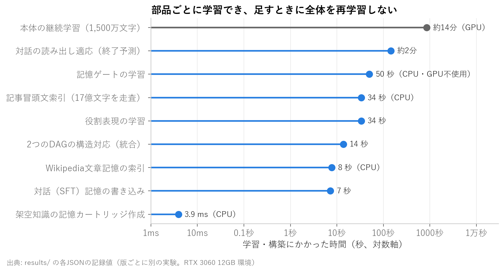
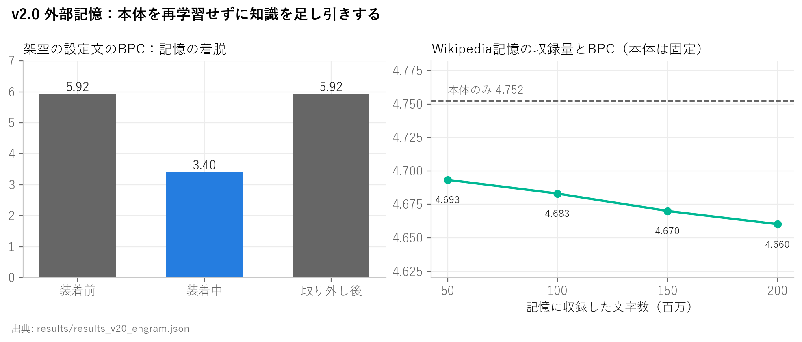
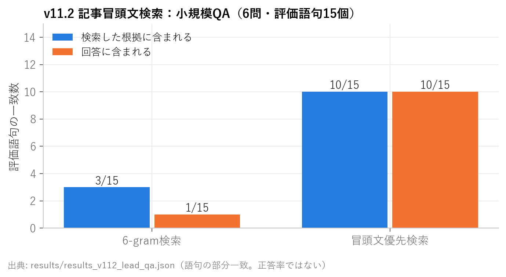
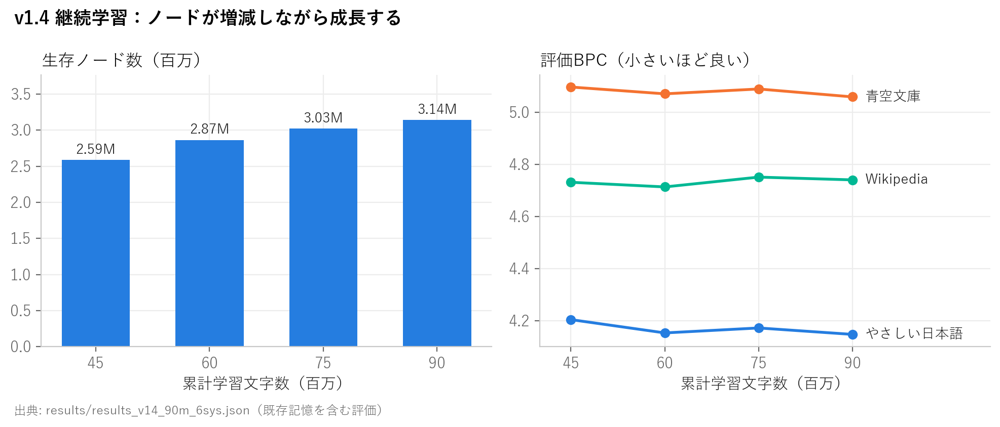

# 過去の記録（v0.1〜v15.2・Python / GPU 版）

この資料は、ENNE の初期開発期（v0.1〜v15.2、RTX 3060 12GB 1枚による Python / PyTorch / Triton / C++ 実装：`src/neurograph/`）の設計と実測結果をまとめたアーカイブです。現行の純 CPU・Rust 版（v25.0、`enne-rs/`）の解説は [README.md](../README.md) を参照してください。

---

## ① 個人でもゼロから知能を育てられる（Python / GPU 版）

**ゼロから。** 本体は、UTF-8の256バイトに対応する感覚ノードだけから始まり、中間のノードは0個です。事前学習済みのモデルや外部のトークナイザーは使わず、学習しながらノードが生まれていきます。

**家庭用GPU 1枚で。** v0.1〜v15.2 の開発はすべてRTX 3060（12GB）1枚で行いました。数百万ノード規模の学習でも、GPUのピーク使用量は次の程度です。

| 実験 | 規模 | GPUピーク |
|---|---|---:|
| v1.4 継続学習（9,000万文字） | 生存ノード約314万 | 5,256 MiB |
| v1.2 500万ノード枠 | 500万ノード | 5,725 MiB |
| v2.2 600万ノード枠（最大構成） | 生存ノード約454万 | 8,562 MiB |
| v15.2 推論時（記憶・索引・ツール・メタ認知込み） | — | 7,323 MiB |

誤差逆伝播を使わないため、勾配やオプティマイザの状態を保持する必要がありません。

**機能を足すときは、短い学習で済みます。**



新しい部品の学習・構築は数ミリ秒から数分で終わり、全体の再学習はいりません。記憶カートリッジ、索引、記憶ゲート、仲裁層、ツール選択、発話、世代管理、メタ認知はCPUだけで動きます（これらの部品の学習・実行で追加されるCUDA割当は0 bytes）。

## ② 知能を学習するだけでなく、設計できる（v0.1〜v15.2）

| 機能 | 機構 | 採用した技術 |
|---|---|---|
| 言語 | 本体（成長するバイトDAG） | 局所予測誤差によるノードの新生・削除・統合 |
| 言語（対話） | 対話用DAG、対話記憶、読み出し適応 | 対話データだけで別に育てたDAG、局所的な読み出し適応 |
| 記憶 | 記憶カートリッジ | CPU RAM / mmap上の文脈統計。着脱可能 |
| 記憶（事実） | 記事冒頭文索引 | 記事の定義文を優先するSQLite索引 |
| 判断 | 記憶ゲート、成長型仲裁層 | ridge回帰、十分統計を使う局所回帰。根拠回答・棄権・雑談を選ぶ |
| 行動 | ツール（計算・時計・本文検索） | プラグインとして登録。どのツールを使うかは弱教師の閉形式学習で育てたノードが選ぶ |
| 発話 | 発話ノード | 決定済みの内容に合う発話候補を、対話データから育てたノードで選ぶ |
| 自己監視 | メタ認知（試作） | 発話前に根拠を監査し、再検索・棄権と自信度を決める |
| 推論 | 応答意図への経路選択（v9） | 探索段階。比較の説明はまだできない |

**機構は交換できます。** 知識は本体の外の記憶カートリッジに置いているので、本体を再学習せずに差し替えられます。



架空の設定文から記憶カートリッジを作るのに3.9ミリ秒でした。装着すると設定文のBPCは5.92から3.40に下がり、外すと5.92に戻ります。Wikipedia記憶の収録量を5,000万文字から2億文字に増やすと、本体を固定したままBPCが4.693から4.660に下がりました。

**機構は個別に改良できます。** 検索の機構だけを、単純な6-gram索引から記事冒頭文を優先する索引に替えたところ、小規模QAで回答に含まれる評価語句が1/15から10/15に増えました。



**機構を後から足し、その効果を分けて測れます。** v13では、計算・時計・本文検索をツールとして登録できるようにし、どのツールを使うかを選ぶ部品（A）と、発話を組み立てる部品（B）を別々に足しました。部品ごとに有効・無効を切り替えられるので、同じ問題でそれぞれの寄与を測れます。問題は、コードとモデルを凍結した後に新しく作り、一度だけ評価しました。

| 構成（v13.1） | 新規10問の正答 |
|---|---:|
| どちらもなし | 2/10 |
| Aだけ | 4/10 |
| Bだけ | 2/10 |
| A＋B | 5/10 |

A＋Bで新たに正答したのは、数式・単位付きの加算・時刻の3問でした。どちらの部品も、追加で使うCUDA割当は0 bytesです。

**パーツごとにデバッグして直せます。** 応答の間違いがどの機構から来たかを特定し、その機構だけを直せます。

- v11.2：6-gram索引が記事の本題ではなく「ついでの言及」を拾うことが原因だと特定し、索引だけを替えて回答を改善しました（上の図）。
- v12.0→v12.2：記憶ゲートが回答に必要な根拠まで閉じてしまい、回答中の評価語句が16/21から6/21に減りました。棄権、冒頭文の品質、複数対象の扱いを個別に直しました。
- v12.5以降：仲裁層・ツール・メタ認知がそれぞれ何を判断したかを、応答ごとにtraceとして記録しています。
- v13.1：計算の候補を選んだのに本文検索の得点がわずかに上回って棄権に戻る、という失敗をtraceから特定しました。ツールの選択と記憶の判断を別の軸に分けると（v13.2、演算の学習も同時に変更）、既存の文章題7問の数値がすべて正しくなりました。
- v14.0：経験からの更新を試したとき、既存の算術（机7台に付箋4枚ずつ）が28枚から11枚に退行しました。世代の採否を決める固定検査がこれを検出して更新を棄却し、演算の転移を制限してから再評価しました。

各機構の詳細は [architecture.md](architecture.md) を参照してください。

## ③ 成長と統合（v1.4〜v14.0）

**神経回路そのものが変化します。** 本体は学習中に、予測を外した箇所でノードを新生し、役に立たないノードを削除し、似たノードを統合します。



9,000万文字までの継続学習では、各段階で57万〜166万のノードが生まれ、45万〜100万のノードが削除されながら、生存ノードが約259万から約314万に増えました。BPCはこの範囲ではほぼ横ばいです。

**別々に育てた回路を、後から1つに統合できます。** ENNEのノードは、256バイトを根とする「どの条件をたどって生まれたか」という経路で特定できます。そのため、別々に学習したDAG同士でも、同じ経路のノードを対応付けて重ね合わせられます。

v11では、対話データだけで別に育てた対話用DAGを、文章で育てた基盤DAGに統合しました。

| 項目 | 値 |
|---|---:|
| 対話用DAGのノード | 524,838 |
| うち基盤DAGと経路が一致したノード | 459,515（87.6%） |
| 対話用DAGにしかないノード | 65,323 |
| 基盤DAGから移植したノード | 4,051,411 |
| 対応が取れずに外したノード | 16 |
| 経路の対応付けにかかった時間 | 13.8秒（勾配計算なし） |

2つのDAGの表現の向きは、256×256の座標変換（ridge回帰で一度解くだけ）でそろえました。変換後の出力の一致度（logitのcos類似度）は0.988です。

| 構成 | GPU割当 | 対話本文BPC | 終了予測 EOT bits |
|---|---:|---:|---:|
| 対話用DAG単体（記憶あり） | — | 3.9794 | 3.145 |
| 2つのDAGを並べて使う（v10.1） | 7,323 MiB | 3.8261 | 2.519 |
| 1つに統合（v11.1） | 5,023 MiB | 3.8727 | 0.840 |

統合でGPU割当は約3割減り、対話の予測は対話用DAG単体より良くなりました。2つを並べて使う構成と比べると、本文BPCはわずかに悪く、終了予測は大きく改善しました（v11.1では統合後に終了予測の読み出しを399秒かけて調整しています）。一方で、統合後の一般文章の予測（3分野平均BPC 5.47）には課題が残っています。

**判断の機構も成長します。** v12.5の仲裁層は、学習中に33ノードが生まれ、10ノードが削除されて23ノードに落ち着きました。v13.1のツール選択ノードは549生まれて80、発話ノードは815生まれて390が残りました。

**使いながら覚え、間違った更新は戻せます（v14）。** 対話中に事実を教えたり（`/teach`）、答えを訂正したり（`/correct`）すると、経験として記録されます。「睡眠」（`/sleep`）でそれらをまとめた新しい世代の候補を作り、固定の検査（既存の回答・棄権・算術が崩れていないか）を通ったときだけ採用します。世代はいつでも前に戻せます（`/rollback`）。

| 試したこと | 結果 |
|---|---|
| 架空の事実を2件教え、時計と加算の誤りを1件ずつ訂正 | 別プロセスで読み直しても、言い換えた質問に答えた（「点検する星紡ぎ試験機は何色でしたか？」→「星紡ぎ試験機の識別色は薄紫色です。」）。訂正していない加算（6km＋9km）にも「15キロメートルです。」と答えた |
| 何も教えずに睡眠 | 棄権した4問のうち、太陽の半径の1問について、本文から根拠を自分で見つけて記憶に加えた |
| 架空の町の町長について、わざと嘘を教える | 候補の世代はその嘘を答えたが、固定検査の棄権問題が15/15から14/15に下がったため、自動で棄却された |
| 最初の世代に戻す | 初期の4問の発話・ツール値・出典が、初期の結果と完全に一致した |

固定検査の外にある嘘まで見抜ける保証はありません。世代管理の部品が追加で使うCUDA割当は0 bytesです。

## v15.2 時点の到達点と限界

**ENNEでは、本体のBPC（1文字あたりのビット数）は最終的な性能の基準になりません。** 応答は検索・選択・判断の組み合わせで決まるため、本体の予測損失と応答の質は連動しません。

- v11.2で検索を冒頭文索引に替えると、回答中の評価語句は1/15から10/15に増えましたが、同じ実験の平均BPCは5.26から5.40に悪化しました。
- v9では、自己採点のBPCが低い回答（平均2.82）を選んでも、回答語句の一致は15個中1個でした。

以下はv15.2（進化世代 `gen_002`）の出力例です。

```text
Q: 富士山とは何ですか？簡単に教えてください。
A: 富士山は、静岡県（富士宮市、富士市、裾野市、御殿場市、駿東郡小山町）と山梨県（富士吉田市、
   南都留郡鳴沢村）に跨る活火山である。標高3776.12 m、日本最高峰（剣ヶ峰）の独立峰で、…

Q: 第二次世界大戦はいつ始まり、いつ終わりましたか？
A: 第二次世界大戦は、1939年（昭和14年）9月1日から1945年（昭和20年）8月15日または9月2日まで
   約6年にわたって続いた…

Q: アストラX-99の最大推力はどのくらいですか？          ← 後から足した記憶にだけある架空の設定
A: アストラX-99の最大推力は従来のイオンエンジンの約400倍であり、火星までの航行時間をわずか18日間に短縮できる。

Q: 架空の都市「ネオアトランティス2099」の市長は誰ですか？
A: ネオアトランティス2099については情報がありません。

Q: こんにちは！調子はどうですか？
A: うまくいってるよ。

Q: (74 - 26) * 3 / 8                                    ← 以下2問は凍結後に作った新規問題
A: 18です。

Q: 作業台に封筒を17枚並べました。さらに6枚の封筒を加えたら、全部で何枚になりますか。
A: 23枚です。
```

苦手な問題の例：

```text
Q: 朝に14枚の切符を用意し、昼に9枚を追加しました。いま切符は合計何枚ですか？
A: 5枚です。                                            ← 足し算を引き算と取り違える

Q: おはよう！ 今朝はどんな調子で過ごしていますか？
A: 宇宙の答えは不合理ではない。                          ← 質問に合わない文を選ぶ
```

**未見の問題での結果（v13.0〜v15.2）。** 版ごとにコード・モデル・索引を凍結した後で新しい10問を作り、一度だけ評価しました。

| 版 | 比べた条件 | 新規10問の正答 |
|---|---|---:|
| v13.0 | ツールなし → あり | 2 → 4 |
| v13.1 | 部品なし / Aだけ / Bだけ / A＋B | 2 / 4 / 2 / 5 |
| v13.2 | ツールなし / 混合 / 二軸 | 1 / 1 / 3 |
| v15.0 | メタ認知なし → あり | 1 → 3 |
| v15.1 | メタ認知なし → あり | 5 → 4 |
| v15.2 | メタ認知なし → あり | 6 → 5 |

既知の31問（回帰評価）では厳格な採点で25/31、架空の対象への棄権5/5、UTF-8として正しい出力とEOTでの終了31/31です。メタ認知（v15）は開発用50問で自信度と正答率の順序が揃いましたが（HIGH 10/13、MEDIUM 2/10、LOW 1/27）、新規10問では正答が6/10から5/10に減りました。全出力は [results/results_v152_metacog.json](../results/results_v152_metacog.json) にあります。

### v15.2 時点の限界

- **本体の予測性能**: 587万パラメータのTransformerを約5分学習した参考値はBPC 3.80、ENNE v1.4 本体（GPU版）は4.23でした（学習データ・語彙 `<UNK>`・計時範囲が異なる参考比較）。600万ノード枠への拡張（v2.2）では3分野ともBPCが悪化しました（Wikipedia 4.75→4.85）。
- **検索と生成**: 知識回答の多くは検索した冒頭文の切り出しで、比較説明ができませんでした。雑談や文章題の演算選択にも取り違えが残っていました。
- **仲裁層とメタ認知**: v12.5 の31問で方式差はなく、v15.1〜v15.2 ではメタ認知ありで新規問題が1問減りました。

詳細な数値は [results.md](results.md)、全版の履歴は [history.md](history.md)、Python/GPU 版の実装ファイル一覧は [source.md](source.md) を参照してください。
